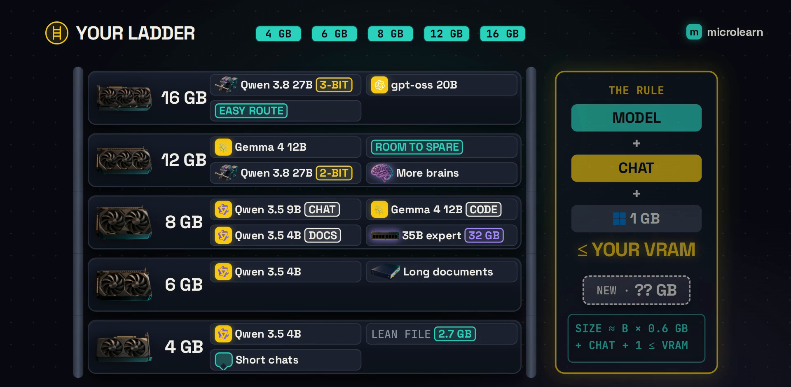

# Best local AI model for your GPU: the cheat sheet

The free cheat sheet from the Microlearn video **Best Local AI Model: 4GB vs 8GB vs 16GB GPUs Explained**.
▶️ Watch: https://youtu.be/I9tcY-0HZp8



## 1. The rule (it outlives every model name)

```
model file  +  chat (context)  +  ~1 GB for the desktop  ≤  your VRAM
```

- **Fits → fast. Spills → crawls.** When it doesn't fit, nothing crashes and you get no error: the app quietly moves the rest to normal RAM and the processor runs that part. One measured test: a 32B model forced onto a 12 GB card ran at **0.4 tokens/s**.
- **Size of the model file at 4-bit ≈ 0.6 GB per billion parameters.** An 8B model ≈ 4.8 GB (a real 8B file came out at 5 GB).
- **The chat takes room too.** One measured test: the same 8B model used ~5 GB with a short chat and ~9 GB with a long one.
- **Windows keeps about 1 GB** of your card for drawing the desktop (if your monitor is plugged into that card).

Quick maths before any download: `billions × 0.6 + chat + 1 ≤ VRAM`.

## 2. Find your real number (30 seconds)

Close games and browsers first: they borrow VRAM too.

**Windows:** `Ctrl` + `Shift` + `Esc` → Task Manager (click *More details* if it's tiny) → **Performance** → your **GPU** (pick the NVIDIA one if you see two) → **Dedicated GPU memory**. The first number is what's already in use.

**Linux (NVIDIA):**
```bash
nvidia-smi --query-gpu=name,memory.total,memory.used --format=csv
```

**Free trick:** if your processor has built-in graphics, plug the monitor into the motherboard instead of the graphics card, and you get most of that desktop gigabyte back for the model.

## 3. The ladder

| Your card | Run this | For | Ollama |
|---|---|---|---|
| **4 GB** | Qwen 3.5 4B in a lean ~2.7 GB 4-bit file (Q4_K_M GGUF); keep chats short (~17K tokens) | short chats, notes | `ollama pull qwen3.5:4b` is 3.3 GB and fills a 4 GB card on its own: use the leaner GGUF. *Estimate, not measured on a 4 GB card.* |
| **6 GB** | Qwen 3.5 4B | long documents | `ollama pull qwen3.5:4b` · measured: 62 tok/s on an RTX 2060 6GB, fully on the GPU up to a 32K-token chat |
| **8 GB** | Qwen 3.5 9B to chat · Gemma 4 12B for code · Qwen 3.5 4B for documents | everything, one model per job | `ollama pull qwen3.5:9b` (41 tok/s) · `ollama pull gemma4:12b` (33/33 tests, ~2 min/answer) · `ollama pull qwen3.5:4b` (10/10 on a 28K-token handbook in 17 s). Our runs, RTX 4060 laptop 8 GB |
| **8 GB + 32 GB RAM** | Qwen 3.6 35B (mixture of experts, only ~3B active per word) | code, fast | `ollama pull qwen3.6:35b` · our run: 40 tok/s with three quarters in RAM, 31/33 tests in 38 s |
| **12 GB** | Gemma 4 12B with room for the chat · or a 2-bit Qwen 3.8 27B (~9.5 GB file) for more brains | code, harder problems | `ollama pull gemma4:12b` · the 2-bit 27B: measured ~30 tok/s fully on an RTX 4070 SUPER 12 GB, a little less smart on hard problems |
| **16 GB** | Qwen 3.8 27B at 3-bit (~11.8 GB file, room for ~62K tokens of chat) · or gpt-oss 20B for the easy route | strong model + long sessions | `ollama pull gpt-oss:20b` (14 GB, fits whole) · the 3-bit 27B is a GGUF (IQ3_S class). *Both estimates at 16 GB.* |

**The 16 GB trap:** `ollama pull qwen3.8:27b` is an **18 GB** download, and the usual 4-bit file is ~16.5 GB. Neither fits once the desktop takes its gigabyte. One measured run of a 4-bit 27B on a 16 GB RTX 5060 Ti: 5–6 tok/s, over an hour per task.

**Same 16 GB, different speed:** speed also depends on how fast the card reads its own memory. One estimate for the same 27B file: ~24 tok/s on an RTX 4060 Ti 16 GB vs ~79 on an RTX 5080.

## 4. Set the chat size yourself

Defaults can be huge. One measured test: an 11 GB file showed **30 GB in use** at the default context; setting it to 8,192 tokens made it about **4× faster**.

In Ollama:
```
# inside a chat
/set parameter num_ctx 8192

# or for every model, before starting the server
OLLAMA_CONTEXT_LENGTH=8192 ollama serve
```
Give the model the chat size you need, not the biggest one it supports.

## Where the numbers come from

- **Our run:** our own RTX 4060 laptop (8 GB VRAM, 32 GB RAM), Ollama. Full results: [../local-llm-8gb-vram-test](../local-llm-8gb-vram-test).
- **Measured:** one public test on that exact card, with the card named.
- **Estimate:** computed from file size, chat size and memory speed; nobody measured it on that card.

Model names will change in a few months. The rule won't: when a new model lands, do the maths before you download it.

---
More from Microlearn: [the Local AI series](https://www.youtube.com/playlist?list=PLJfzsP_xwvZk) · [YouTube channel](https://www.youtube.com/channel/UCeuNfb2Ng20RYw8qEkUut0A)
